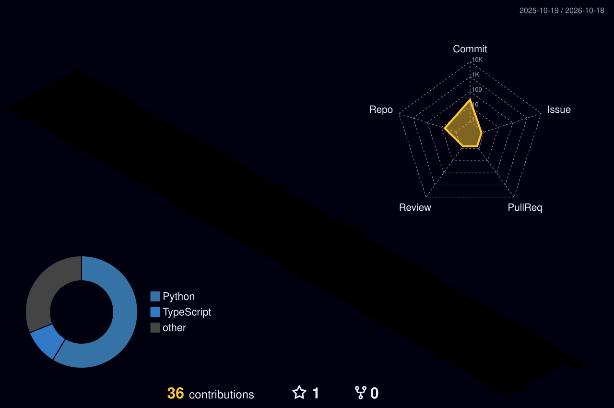

**2+ years building AI automation, GenAI workflows and production backend systems**

[LinkedIn](https://linkedin.com/in/priyanshu-k24) · [Credly](https://credly.com/users/priyanshu-kumar25) · [GitHub](https://github.com/loophole-debug)

---

### 🏙️ My Contribution City (3D)

---

### 📌 Snapshot

| | |
|---|---|
| 💼 **Role** | Software Engineer at HCLTech (TechBee Work Integrated Learning Program) |
| ⏳ **Experience** | 2+ years |
| 🎓 **Education** | BCA, Amity University Online (graduating 2028) |
| 📍 **Location** | Delhi NCR, India |
| 🔭 **Focus** | AI Agents, GenAI Workflows, Backend Systems, Responsible AI |
| 🗣️ **Languages** | Hindi, English, Gujarati |

---

### 🚀 Public Projects

| Project | What it does | Built with |
|---|---|---|
| [SAR-STR-Investigation-Copilot](https://github.com/loophole-debug/SAR-STR-Investigation-Copilot) | Evidence-grounded AML SAR/STR investigation copilot with live LLM reasoning, synthetic case data, citation checks, audit trace and mandatory human review guardrails | Python · FastAPI · OpenAI API |
| [amd-devassist](https://github.com/loophole-debug/amd-devassist) | AI developer assistant to speed up engineering workflows | TypeScript |
| [summarizer-agent](https://github.com/loophole-debug/summarizer-agent) | AI agent that turns long content into clear summaries | Python |
| [Food-Health-App](https://github.com/loophole-debug/Food-Health-App) | Food and health application | Python |

---

### 🛠️ Tech Stack

| Area | Tools |
|---|---|
| **Languages** | `Python` · `TypeScript` · `JavaScript` · `SQL` · `Bash` |
| **AI / LLM** | `OpenAI API` · `Claude API` · `Gemini API` · `LangChain` · `LlamaIndex` · `Hugging Face` · `Ollama` |
| **Agents** | `Tool / Function Calling` · `Model Context Protocol (MCP)` · `Multi-step Workflows` · `Structured Outputs` |
| **RAG & Data** | `Embeddings` · `ChromaDB` · `pgvector` · `Pandas` · `NumPy` · `Pydantic` |
| **Backend** | `FastAPI` · `Node.js` · `REST APIs` · `WebSockets` · `Async Python` |
| **Databases** | `PostgreSQL` · `MongoDB` · `Redis` · `SQLite` |
| **Frontend** | `React` · `Next.js` · `Tailwind CSS` · `Streamlit` |
| **Cloud & DevOps** | `Docker` · `GitHub Actions (CI/CD)` · `Linux` · `AWS` · `Azure` · `GCP` |
| **Quality & Tools** | `Git` · `GitHub` · `pytest` · `Postman` · `VS Code` · `Jupyter` |

---

### 🧭 How I Build

- 🔍 **Grounded:** every AI answer traces back to evidence and citations
- 🧾 **Auditable:** logs and traces so every decision can be reviewed
- 🧑‍⚖️ **Human in the loop:** mandatory review for high-stakes outputs
- 🧱 **Scalable:** clean APIs, async services, containerized deployment

---

### 🌱 Currently

- 🤖 Building AI agents and GenAI workflows
- 📚 Learning: advanced agent architectures, scalable backend design, MCP integrations
- 💡 Open to: AI automation projects, freelance work and collaborations

---

### 📫 Connect

**[LinkedIn](https://linkedin.com/in/priyanshu-k24)** · **[Credly](https://credly.com/users/priyanshu-kumar25)** · **[GitHub](https://github.com/loophole-debug)**

*Building useful AI, one shipped project at a time.* 🚀

